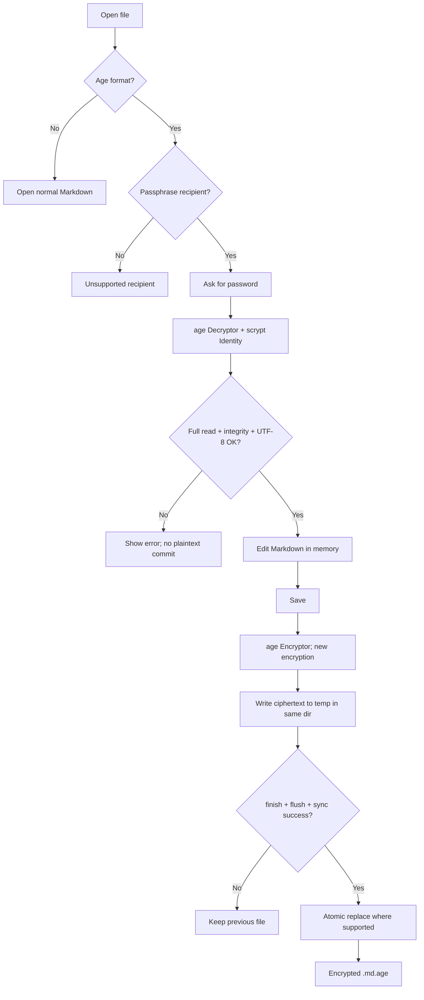

# План: шифрование Markdown-файлов с помощью age (Rust)

**Статус:** MVP реализован локально; платформенные и security-гейты выпуска открыты\
**Версия документа:** 1.1\
**Дата:** 2026-10-16\
**Основной выбор:** [`age`](https://docs.rs/age/0.12.1/age/) + passphrase (`scrypt`)\
**Формат:** стандартный `age-encryption.org/v1`, без собственного криптографического контейнера.

Реализация: T-218, ADR-013. Проверенные сценарии и незакрытые пункты — в
[`AGE_MARKDOWN_ENCRYPTION_VALIDATION.md`](AGE_MARKDOWN_ENCRYPTION_VALIDATION.md).
Отметки ниже разделяют реализованный код и проверку публичного выпуска.

## 1. Цель и решение

Добавить в существующее Rust-приложение возможность создавать, открывать, редактировать и сохранять зашифрованные Markdown-документы. Пользователь задаёт пароль, приложение шифрует содержимое по стандарту **age**. Зашифрованный файл можно открыть в приложении или расшифровать сторонним совместимым инструментом (`age`/`rage`).

**Решение для MVP:**

- Обычный Markdown хранится в `name.md`.
- Зашифрованный Markdown хранится в **`name.md.age`** (двоичный age-формат, не ASCII armor).
- Каждый документ шифруется **отдельно**, паролем пользователя.
- Используем `age::Encryptor::with_user_passphrase(...)` и `age::scrypt::Identity`.
- **Не** создаём и **не** храним собственный ключ, salt, nonce или параметры KDF: формат и библиотека age управляют ими сами.
- Сохранение зашифрованного документа производится только в формате `.md.age`, без временной незашифрованной копии на диске.
- Разблокированный Markdown существует в памяти редактора до закрытия или блокировки документа.

### Не входит в MVP

- Синхронизация между устройствами, облачный сервер и совместная работа.
- Единый Vault с одним паролем для всех файлов.
- Публичные ключи `age`/X25519 и совместный доступ по нескольким получателям.
- Восстановление потерянного пароля (оно принципиально невозможно без заранее предусмотренного recovery-механизма).
- Обфускация имён файлов, размеров, структуры директорий и количества заметок.
- ASCII-armored `.age` как формат для записи (при необходимости можно добавить чтение позже).

## 2. Почему age, а не собственное шифрование

**age** уже определяет формат файла, защищённый случайный file key, механизм получателей (recipients), парольный режим, проверку целостности и потоковую обработку.

В режиме пароля:

1. Пользователь вводит пароль.
2. `age` генерирует случайный **file key** для очередного шифрования.
3. Пароль через **scrypt** используется для защиты (обёртывания) file key.
4. В стандартный заголовок age помещаются сведения, нужные для расшифрования: scrypt-stanza, salt, work factor и зашифрованный file key.
5. Содержимое документа шифруется age с проверкой целостности.
6. Для открытия файла пароль повторно передаётся `age::scrypt::Identity`; библиотека извлекает file key и расшифровывает содержимое.

**Следствия:**

- В MVP не нужен `argon2` и не требуется своя функция `derive_key()`.
- Не нужен реестр ключей, отдельный `.key`-файл или master key.
- Один и тот же пароль допустимо использовать для нескольких файлов: у каждого шифрования собственные случайные значения и file key.
- Файлы сохраняют совместимость с внешними инструментами age/rage.

> Важно: пароль должен быть достаточно сильным. Формат age не скрывает факт шифрования и не спасает от утечки пароля или компрометации работающего компьютера.

## 3. Пользовательские сценарии (UX)

### 3.1 Создать защищённую заметку

1. **New note** → **Encrypt / Password protect**.
2. Пользователь вводит пароль и подтверждает его.
3. Приложение создаёт `note.md.age`; на диске никогда не появляется промежуточный `note.md`.
4. В интерфейсе отображается 🔒 и статус **Encrypted**.
5. Предупреждение: без пароля содержимое восстановить нельзя.

### 3.2 Открыть защищённую заметку

1. Пользователь выбирает `note.md.age` (или приложение обнаруживает его при сканировании папки).
2. Приложение проверяет, что это age-файл, и что его режим — passphrase/scrypt.
3. Показывает окно **Unlock note**.
4. Пользователь вводит пароль.
5. Приложение полностью расшифровывает и проверяет содержимое, затем валидирует UTF-8.
6. Только после успешного завершения Markdown показывается редактору.
7. Неправильный пароль, повреждение файла и неподдерживаемый режим имеют понятные сообщения.

### 3.3 Редактировать и сохранять

1. Пользователь меняет Markdown в памяти.
2. **Save** → повторно шифрует актуальный текст и безопасно записывает `note.md.age`.
3. Новый зашифрованный файл заменяет старый **только после** успешной записи и завершения шифрования.
4. При ошибке старый файл остаётся на месте, редактор сохраняет несохранённые изменения в памяти.
5. **Lock / Close** → сбрасывает редактор и секреты, насколько это возможно в выбранном GUI/framework.

**Решение для MVP:** пока заметка открыта, пароль можно держать в памяти сеанса, чтобы не спрашивать его при каждом сохранении. При Lock, Close или выходе приложения пароль должен быть отброшен. Автосохранение либо отключено, либо пишет **только ciphertext** по тому же безопасному алгоритму.

### 3.4 Зашифровать существующую `.md`

1. **Encrypt existing note** → ввод нового пароля два раза.
2. Добавить `.age` к полному исходному имени (`note.md` → `note.md.age`, `Readme.MARKDOWN` → `Readme.MARKDOWN.age`), записать и проверить копию.
3. Открыть защищённое превью и показать **Keep original / Delete original**. При удалении сначала сохранить точные байты исходника в encrypted `pre_encrypt_delete`, сверить хеши обоих файлов до и после снимка. Keep или закрытие диалога оставляет исходник без изменений.
4. Не обещать «безвозвратное удаление»: SSD, snapshots, облачные версии, backups и история редактора могут сохранить plaintext.
5. По умолчанию не удалять оригинал молча; объяснить риск сохранения незашифрованной копии и дать явное подтверждение на её удаление.

### 3.5 Изменить или снять пароль

- **Change password:** полностью расшифровать с текущим паролем → зашифровать с новым → безопасно заменить файл. Простой «замены пароля в заголовке» в MVP не реализуем.
- **Remove encryption:** явно экспортировать `name.md` после подтверждения пользователя; предупредить, что появляется открытая копия.
- **Forgot password:** не предлагать ложный recovery; объяснить, что ключ не хранится приложением.

## 4. Идентификация зашифрованного файла

### Расширения

- `.md` — обычный Markdown.
- Markdown-расширение (`.md`, `.markdown`, `.mdown`, `.mdwn`) с суффиксом `.age` — ожидаемый зашифрованный Markdown.
- `.age` — потенциально любой зашифрованный файл, нельзя автоматически считать его Markdown.

### Проверка по содержимому

Двоичный age-файл формата v1 начинается с:

```text
age-encryption.org/v1\n
```

Это **распознаваемая сигнатура**, но не подтверждение подлинности и не достаточная проверка валидности файла.

**Алгоритм детектирования:**

1. Посмотреть расширение — только как UX-подсказку.
2. Прочитать заголовок через `age::Decryptor::new(...)` / `new_buffered(...)`.
3. Если парсер отверг файл — показать ошибку формата или предложить открыть как обычный файл в зависимости от контекста.
4. Если `decryptor.is_scrypt() == true` — запросить пароль.
5. Если `false` — показать **Unsupported age recipient type** (в MVP ключи X25519 и другие recipients не поддерживаются).
6. Проверить содержимое только после полной успешной дешифровки и чтения до EOF.

**Не** заменять этот механизм проверкой одного расширения или первых байт.

### Дополнительные форматы

ASCII armor начинается с `-----BEGIN AGE ENCRYPTED FILE-----`. В MVP **не создаём armor**. Если потребуется импорт текстовых age-файлов, используем `age::armor::ArmoredReader` и явно включаем Cargo feature `armor`.

## 5. Rust dependencies и API

Рекомендуемый старт (`age` на дату подготовки документа: **0.12.1**, pre-1.0/beta):

```toml
[dependencies]
age = "=0.12.1"
thiserror = "2"
# для управления временными файлами / безопасной замены:
tempfile = "3"
# опционально: дополнительное управление секретами приложения
# zeroize = "1"
```

`age` уже предоставляет `age::secrecy::SecretString`. Не передавать пароль в логах, telemetry, panic-тексте и именах файлов. Версию `age` перед выпуском фиксировать через `Cargo.lock`; миграции API проверять отдельно, поскольку crate ещё до 1.0.

**Проверенные точки API:**

```rust
use age::{secrecy::SecretString, Encryptor, Decryptor};

// Encryption:
let encryptor = Encryptor::with_user_passphrase(passphrase);
let mut writer = encryptor.wrap_output(destination)?;
// writer.write_all(markdown_bytes)?;
// writer.finish()?; // ОБЯЗАТЕЛЬНО

// Decryption:
let decryptor = Decryptor::new(source)?;
let is_passphrase = decryptor.is_scrypt();
// let identity = age::scrypt::Identity::new(passphrase);
// let mut reader = decryptor.decrypt(std::iter::once(&identity as &dyn age::Identity))?;
// reader.read_to_end(&mut plaintext)?; // ОБЯЗАТЕЛЬНО проверить конец и ошибки
```

> Это **эскиз API**, а не самостоятельная компилируемая программа: `source`, `destination`, `passphrase` и обработка `Read`/`Write` подставляются реальными объектами. Для небольших заметок допустим `age::encrypt(...)`/`age::decrypt(...)` с `age::scrypt::Recipient`/`Identity`.

### Архитектура модулей

```text
src/
  crypto/
    mod.rs
    age_crypto.rs      # единственная реализация age
    detection.rs       # age/scrypt/markdown/unknown
    errors.rs          # ошибки, пригодные для UX
  documents/
    mod.rs
    document.rs        # текст, dirty, lock state
    repository.rs      # чтение, атомарная запись
    migration.rs       # .md -> .md.age, export
  app/
    commands.rs        # команды/handlers GUI/CLI
```

### Публичный интерфейс сервиса (проект API)

```rust
pub enum DocumentFormat {
    PlainMarkdown,
    AgePassphrase,
    AgeUnsupportedRecipient,
    InvalidOrUnknown,
}

pub fn detect_format(path: &std::path::Path) -> Result<DocumentFormat, CryptoError>;
pub fn encrypt_markdown(
    markdown: &[u8],
    passphrase: age::secrecy::SecretString,
) -> Result<Vec<u8>, CryptoError>;
pub fn decrypt_markdown(
    encrypted: &[u8],
    passphrase: age::secrecy::SecretString,
) -> Result<String, CryptoError>;
pub fn save_encrypted_atomic(
    path: &std::path::Path,
    markdown: &[u8],
    passphrase: age::secrecy::SecretString,
) -> Result<(), CryptoError>;
```

В более крупном приложении для многократного сохранения лучше передавать ссылку на собственный контейнер секретов сеанса, а не повсюду клонировать `SecretString`.

### Схема потока данных



## 6. Безопасная запись файлов

Последовательность для **Save**:

1. Проверить путь, права доступа, ожидаемый тип файла; не перезаписывать чужой файл неожиданно.
2. Создать временный файл **в том же каталоге** (чтобы rename оставался операцией в одной файловой системе), с закрытыми правами доступа.
3. Направить поток `age::Encryptor` сразу в этот временный файл — **не писать plaintext на диск**.
4. Полностью записать содержимое; обязательно вызвать `StreamWriter::finish()`.
5. `flush()` / `sync_all()` для файла; по необходимости задокументировать требования к durability.
6. Заменить целевой файл атомарным rename/replace API, где это гарантируется платформой; для Windows предусмотреть особенности замены открытого файла. Не использовать схему «удалить старый, потом переименовать новый».
7. При необходимости синхронизировать каталог для повышенной crash-durability (поддержка зависит от ОС).
8. При сбое оставить старый документ нетронутым; временный ciphertext убрать.

**Детали:**

- При шифровании используем новый file key/случайные значения, генерируемые `age`; не пытаемся вручную задавать nonce.
- Для Markdown обычного размера достаточно расшифровать всё в память, прежде чем отдавать в UI.
- При потоковом чтении часть plaintext может поступить до окончательной проверки всех данных; UI/экспорт не должен считать файл успешно расшифрованным до полного окончания операции без ошибок.
- Не помещать расшифрованный документ в системную папку temp, thumbnails, crash reports, поисковый индекс или plugin API по умолчанию.
- Приложение должно предупреждать о возможности хранения данных в swap, hibernation, буфере обмена, резервных копиях и history; очищение памяти не даёт абсолютной гарантии.

## 7. Состояние редактора и секреты

```text
Closed
  └── open encrypted --> Locked
Locked
  └── correct password --> Unlocked
Unlocked
  ├── edit --> Dirty
  ├── lock/close --> Locked / Closed
  └── save --> Unlocked
Dirty
  ├── save success --> Unlocked
  ├── save failure --> Dirty (in-memory changes intact)
  └── lock/close --> prompt: Save / Discard / Cancel
```

Правила:

- Не писать пароль в `config`, SQLite, localStorage, telemetry и логах.
- Держать пароль только во время активной разблокированной сессии документа.
- По **Lock**, **Close**, logout, таймауту блокировки очищать ссылку на пароль и буферы редактора настолько полно, насколько позволяет GUI.
- При неверном пароле не изменять файл и не показывать частично дешифрованный Markdown.
- Ошибки разделять на `NotAgeFile`, `UnsupportedRecipient`, `DecryptionFailed`, `InvalidUtf8`, `IoError`, `SaveConflict`; пароль и содержимое не включать в ошибки.
- Работу scrypt вынести из UI thread / event loop, чтобы интерфейс оставался отзывчивым.
- Ограничить размер входного файла, ресурсы для дешифрования, защититься от патологически дорогих scrypt-параметров в недоверенных файлах. Проверить возможности используемой версии `age` и политику отказа.
- Не допускать одновременного сохранения одного файла разными вкладками/процессами без контроля конфликтов (`mtime`/file hash перед replace).

## 8. Этапы реализации

### Phase 1 — CryptoService (P0)

- [x] Подключить `age = "=0.12.1"` и зафиксировать зависимости.
- [x] Реализовать `encrypt_markdown` для passphrase.
- [x] Реализовать `decrypt_markdown` через `scrypt::Identity`.
- [x] Реализовать `detect_format`, включая `Decryptor::is_scrypt()`.
- [x] Обязательно завершать writer через `finish()` и reader через полный `read_to_end()`.
- [x] Написать типизированные ошибки и тесты round-trip.

**Готово, когда:** Unicode Markdown шифруется/расшифровывается без потерь; неверный пароль и изменённые байты приводят к ошибке; файл читается внешней утилитой `rage`.

### Phase 2 — Filesystem repository (P0)

- [x] Создать сохранение через ciphertext-only временный файл и надёжную замену.
- [x] Сохранять только в `.md.age`.
- [~] Portable API и тесты отказов реализованы; реальные Windows/Linux permissions/disk full/rename ещё проверить.
- [x] Проверять конфликты записи с другими процессами или вкладками.
- [x] Добавить recovery-поведение для оставшегося после сбоя зашифрованного temp.

**Готово, когда:** ошибка записи не уничтожает рабочую старую версию и plaintext не создаётся на диске в ходе шифрования.

### Phase 3 — UI / document lifecycle (P0)

- [x] Add **Encrypt note** и окно ввода/подтверждения пароля.
- [x] Add **Unlock note**, **Lock note**, отображение статуса 🔒.
- [x] Подключить `Locked / Unlocked / Dirty` state machine.
- [x] По сохранению шифровать без дополнительного запроса пароля, пока заметка разблокирована.
- [x] Показывать понятные ошибки без раскрытия деталей секрета.
- [x] Убрать plaintext из логирования, автосохранения и несогласованных temp-файлов.

**Готово, когда:** полный сценарий create → edit → save → close → reopen → unlock работает без CLI и без plaintext на диске.

### Phase 4 — Migration и interoperability (P1)

- [x] Добавить **Encrypt existing `.md`**.
- [x] Добавить **Export decrypted `.md`** с предупреждением о рисках.
- [x] Добавить **Change password** через расшифрование/повторное шифрование.
- [x] Проверить совместимость с внешними `age` и `rage` в обе стороны.
- [x] Написать руководство о бэкапах, паролях, миграции и потерянном пароле.

**Готово, когда:** пользователь может уйти из приложения и открыть данные независимым инструментом.

### Phase 5 — Hardening (P1, до публичного выпуска)

- [ ] Тестировать Windows, macOS, Linux (если эти платформы поддерживаются).
- [x] Локально проверены симлинки, stale hash и race перед replace, небезопасные пути, лимиты/1 MiB и повреждённые заголовки.
- [ ] Замерить задержку scrypt на целевых устройствах.
- [ ] Проверить отсутствие содержимого/пароля в crash reports, поиске, автосохранении.
- [x] Настроить CI: `cargo fmt --check`, `cargo clippy`, `cargo test`; Windows дополнен crypto/encrypted tests.
- [ ] Провести security review поведения с секретами и диском.

## 9. Матрица тестов

| Сценарий | Ожидаемый результат |
|---|---|
| Пустой Markdown | Шифруется и возвращает пустую строку |
| UTF-8/кириллица/emoji/CRLF | Round-trip без изменения байтов или намеренной нормализации |
| Большая заметка | Успешно открывается и сохраняется в пределах ресурсов |
| Неверный пароль | Ошибка; файл не меняется; текст не появляется |
| Обрезанный ciphertext | Ошибка при чтении/проверке; нет частичного открытия |
| Изменённый ciphertext/header | Ошибка проверки целостности/формата |
| Обычный `.md` | Открывается как plaintext, без запроса пароля |
| `.md.age` со случайным мусором | Ошибка, не запрос пароля вслепую |
| `age`-файл с X25519 recipient | Unsupported recipient в MVP |
| Два сохранения того же текста/пароля | Разные ciphertext (вероятностно) |
| Отказ/закончился диск посреди Save | Старая версия доступна |
| Конфликт двух редакторов | Пользователь получает предупреждение |
| Encrypt in app → decrypt via `rage` | Успех |
| Encrypt via `age -p` → decrypt in app | Успех |
| Ошибка UTF-8 после успешной дешифровки | `InvalidUtf8`, никакого silent replacement |
| Закрытие с Dirty state | Save / Discard / Cancel |

Интеграционные тесты запускать в изолированном временном каталоге, с тестовыми паролями. Они не должны выводить секреты в CI-логи.

## 10. Критерии приёмки MVP

- [x] Открытые `.md` продолжают работать без регрессий.
- [x] Можно создать защищённый `.md.age` и повторно открыть его по паролю.
- [x] Незашифрованный Markdown не появляется на диске при сохранении защищённой заметки.
- [x] Пароль/ключ не сохраняются в долгоживущем хранилище.
- [x] Формат определяется через парсер age, а не только по расширению.
- [x] Полная проверка целостности выполняется до отображения текста.
- [x] Ошибка записи не разрушает предыдущую версию документа.
- [x] Есть защита от случайной перезаписи изменений другого процесса.
- [x] Файл расшифровывается внешним совместимым инструментом (`age`/`rage`).
- [ ] Пройдено тестирование на поддерживаемых ОС и security review: выпуск заблокирован до закрытия гейтов из validation record.

## 11. Путь развития: Vault (не MVP)

Если в будущем понадобится **один пароль для разблокировки всей библиотеки заметок**, не стоит многократно расшифровывать каждый `.md.age` одним и тем же паролем при каждом открытии.

Более подходящий вариант:

1. Генерировать `age::x25519::Identity` для пользователя/хранилища.
2. Приватную identity хранить **зашифрованной пользовательским master password** (или защищать ключом, доступ к которому предоставляет системное хранилище секретов).
3. Каждый документ шифровать через `age::Encryptor::with_recipients(...)` для соответствующего public recipient.
4. Пользователь один раз разблокирует identity на сессию; далее приложение открывает документы без повторного дорогостоящего scrypt на каждом файле.
5. Изменение master password требует перешифровать **только хранилище приватной identity**, а не все документы.

**Компромисс:** эти документы останутся стандартными `.age`, но **не смогут расшифровываться одним паролем без identity-файла**. Переход от passphrase-файлов MVP к Vault потребует явной миграции (расшифровать и зашифровать заново). Делать такую миграцию только после продуманной схемы резервного копирования ключей.

## 12. Источники и проверяемые API

1. [Rust crate `age` 0.12.1](https://docs.rs/age/0.12.1/age/) — примеры passphrase encryption/decryption и предупреждение о версии до 1.0.
2. [`Encryptor::with_user_passphrase`](https://docs.rs/age/0.12.1/age/struct.Encryptor.html) — создание парольно зашифрованного age-файла; обязательность `StreamWriter::finish()`.
3. [`Decryptor::is_scrypt`](https://docs.rs/age/0.12.1/age/struct.Decryptor.html) — проверка, что файл предназначен для парольной расшифровки.
4. [C2SP age file format specification](https://c2sp.org/age@v1.0.0) — стандартный заголовок `age-encryption.org/v1` и криптографическая структура.
5. [rage CLI (Rust)](https://github.com/str4d/rage) и [age CLI (Go)](https://github.com/FiloSottile/age) — внешние реализации для interoperability tests.

---

**Следующий шаг до выпуска:** выполнить native Windows/Linux проверки, разобрать оставшиеся dependency warnings и завершить security review. По согласованию с пользователем Ammonia обновлён до 4.1.8; `cargo audit` и `cargo deny check` проходят. Собственный контейнер или key storage не добавлены.
