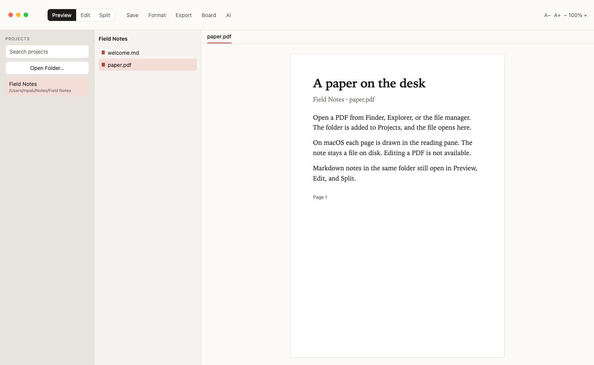

# Formats

1537paperstreet opens the files that already live in a folder. Markdown is the
reading and writing format. PDFs and images open in Preview. Other UTF-8 text
opens in the editor.

## Open from the file manager

Opening a `.md` or `.pdf` with 1537paperstreet — from Finder, Explorer, or the
file manager — adds the file’s folder to Projects if it is not there yet, then
opens the file. File → Open File… and dropping a `.md` or `.pdf` on the window
do the same. Opening the folder itself adds the project without focusing a file.

The app is listed under Open With. It does not replace the default editor.
After a new build is installed, open the app once so the system records that
list. To make 1537paperstreet the default, use the file manager’s Get Info /
Properties → Open with.

Dropping onto a row in a project that is already open copies the files into
that folder instead of registering a new project.

## What opens where

| Kind | Names | In the app |
| --- | --- | --- |
| Markdown | `.md`, `.markdown`, `.mdown`, `.mdwn` | Preview, Edit, and Split. Save and Format work. |
| Protected notes | the same names with `.age` added | Preview until you unlock. Then the same editing as Markdown. |
| PDF | `.pdf` | Preview only. Pages are drawn on macOS. Linux and Windows use the system viewer when it can show a PDF. |
| Images | `.png`, `.jpg`, `.jpeg`, `.gif`, `.webp`, `.svg`, `.bmp`, `.ico`, `.avif`, `.tif`, `.tiff` | Preview only. SVG is shown as an image, so scripts in the file do not run. |
| Source | `.js`, `.ts`, `.rb`, `.ex`, `.go`, `.rs`, `.cs`, `.java`, `.php`, and the related names | The editor, with highlighting when a grammar exists. |
| JSON | `.json` | The editor. Format pretty-prints it. |
| Other text | UTF-8, including names with no extension | The editor. Highlighting is used when a grammar exists. |
| Too large or not text | over 8 MB, or bytes that are not UTF-8 | A short message. The bytes are not shown as text. |

PDF and images cannot be saved from the editor. Use Open in External Editor
when another program should change them.

The first 40 pages of a PDF are drawn on macOS. A longer file says how many
pages were left out. Content search does not read PDF bytes.

## Markdown on the page

Preview renders GitHub Flavored Markdown: tables, strikethrough, task lists,
footnotes, alerts (`> [!NOTE]`), definition lists, YAML front matter, wiki
links (`[[Note]]`, `[[Note|label]]`), fenced code, Mermaid diagrams, and KaTeX
math (`$...$`, `$$...$$`). Images in a note use the formats in the table above.

Export PDF (⌘⌥E) writes a snapshot of that page. It is separate from opening
a `.pdf` you already have. See [Export](export.md).
